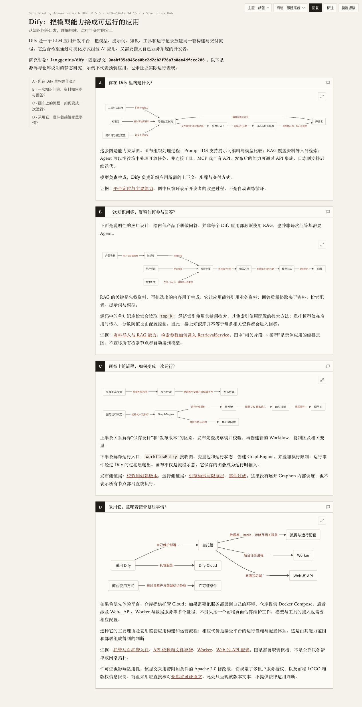

# How This Works

**OnePage to understand how a project works.**

[简体中文](README.md) · **English**

Give your Agent a code repository, a Skill, or a documentation project. How This Works (HTW) turns it into one illustrated, source-backed explanation: **what it does, how its main capabilities cooperate, and which prerequisites and limits affect its use.** It builds an overall understanding for developers encountering the project for the first time, delivered as an HTML page and an editable Markdown draft.

## See the result: Dify on one page

[Open the complete page](https://nnnoidea.github.io/how-this-works--OnePage/demos/dify-comparison/htw/) · [HTML file](docs/demos/dify-comparison/htw/index.html)

*Real full-page screenshot; click to enlarge. This example is in Chinese; studies can be authored directly in your requested language. Open the live page or download the HTML to read offline.*

## Compared with using the Answer Skill directly

Same Dify source, same task, **GPT-6.1 Sol / low** in both conditions. In this run, the direct Answer Skill output focused too heavily on Workflow execution and troubleshooting details to provide a OnePage understanding of the whole project. HTW instead connected the main capabilities, operation and adoption conditions.

[Open the original Answer page](https://nnnoidea.github.io/how-this-works--OnePage/demos/dify-comparison/answer/) · [Answer HTML file](docs/demos/dify-comparison/answer/index.html)

| Author condition | Uncached input tokens | Cached input tokens | Output tokens | Total tokens |
| --- | ---: | ---: | ---: | ---: |
| Answer | 46,822 | 548,608 | 4,992 | 600,422 |
| HTW | 28,613 | 543,360 | 5,110 | 577,083 |

Both took about 116 seconds; the pages retain their first deliveries. Totals include cache, are not prices, and exclude external review. This single comparison does not establish general quality or cost superiority. [Method and full findings](docs/demos/dify-comparison/README.md)

## Use it

Ask your Agent to install the [Skill folder](skills/how-this-works-onepage), then ask:

> Use How This Works to explain `<repository URL or local path>` in one visual page.

## Credits

HTW is adapted from [Answer Me with HTML](https://github.com/QingYunA/answer-me-with-html). Answer supplies the page layout, themes, diagram components and interactions. HTW adapts the research objective and visual requirements for OnePage project understanding, and adds source-reference and page-link checks. The bundled renderer is unmodified; its on-page attribution, MIT license and [third-party notice](skills/how-this-works-onepage/THIRD_PARTY_NOTICES.md) are retained.
